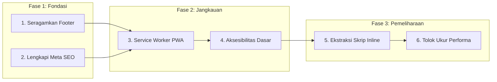
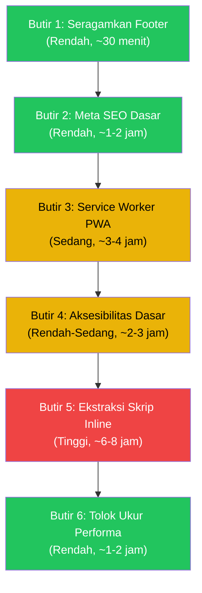

# PDF Tools — Rencana Pengembangan dan Optimalisasi

> Dokumen ini adalah peta jalan pengembangan lanjutan proyek PDF Tools,
> disusun berdasarkan audit menyeluruh terhadap kode, pengujian, dan arsitektur yang ada.
> Seluruh rencana tunduk pada aturan yang tercantum di `PROJECT_RULES.md`.

---

## Ringkasan Kondisi Proyek Saat Ini

Proyek PDF Tools sudah berada dalam kondisi rilis yang matang dan stabil:

| Aspek | Status |
|---|---|
| Pemrosesan 100% di perangkat | Terverifikasi oleh `test_no_external_urls.js` |
| Pengujian otomatis | 28 suite unit/integrasi + 20 suite Playwright browser |
| Responsif seluler | Terverifikasi di 7 resolusi (360--430 px), sentuh, Chromium dan WebKit |
| Keamanan | Enkripsi AES-256, redaksi permanen, sanitasi tanda tangan digital |
| Dwibahasa (EN/ID) | Toggle dengan persistensi, bawaan Inggris |
| Kualitas kode | Lint bersih (ESLint), SVG monokrom konsisten, zero emoji, zero dialog bawaan |
| Jumlah alat | 23 halaman standalone + PDF Studio |

**Tidak ada kerusakan fungsional yang harus segera diperbaiki.**
Seluruh butir di bawah ini bersifat peningkatan kualitas, bukan perbaikan darurat.

---

## Daftar Butir Pengembangan



---

## Butir 1 — Seragamkan Struktur Footer di Seluruh Halaman

### Latar Belakang

Fungsi `setupUnifiedFooter()` di `js/app.js` mengganti isi elemen `<footer class="footer">`
dengan struktur terpadu (teks, kredensial DN., tautan lisensi). Namun hasil audit menemukan
tiga ketidakkonsistenan:

**2 halaman tidak memiliki elemen `<footer>` sama sekali** -- footer tidak muncul:

| Halaman | Keterangan |
|---|---|
| `pages/page-number.html` | Tidak ada tag `<footer>` |
| `pages/protect.html` | Tidak ada tag `<footer>` |

**4 halaman memiliki struktur footer lama yang kompleks** -- ditimpa saat runtime oleh JS,
tetapi isi HTML statis tidak seragam dan sempat terlihat sebelum JS selesai dimuat
(*flash of unstyled content*):

| Halaman | Baris | Struktur |
|---|---|---|
| `pages/crop.html` | 276--287 | `footer-inner` / `footer-brand` / `footer-desc` dengan logo SVG |
| `pages/flatten.html` | 124--135 | Sama dengan crop |
| `pages/grayscale.html` | 382--393 | Sama dengan crop |
| `pages/ocr.html` | 705--716 | Sama dengan crop |

**16 halaman lainnya** sudah menggunakan footer sederhana yang ditimpa dengan benar.

### Tindakan

1. Tambahkan `<footer class="footer"></footer>` pada `page-number.html` dan `protect.html`
   agar `setupUnifiedFooter()` dapat menyuntikkan isinya.
2. Ganti struktur footer kompleks di 4 halaman (`crop`, `flatten`, `grayscale`, `ocr`)
   dengan footer sederhana yang seragam:
   ```html
   <footer class="footer">
     <div class="container">
       <p data-i18n="footer.text">PDF Tools (DN.) — All processing is done locally in your browser.</p>
     </div>
   </footer>
   ```
3. Pastikan tidak ada *flash of unstyled content* karena isi statis dan isi JS sudah selaras.

### Kriteria Penerimaan

- Seluruh 22 halaman standalone (kecuali `viewer.html`) menampilkan footer terpadu yang identik.
- `npm test`, `npm run lint`, dan `npm run test:browser` lulus tanpa kegagalan.
- Tidak ada perubahan pada `pages/viewer.html`, `js/studio/`, atau `js/core/pdf-studio.js`.

### Perkiraan Cakupan

- Berkas diubah: 6 halaman HTML
- Risiko: Rendah -- perubahan murni markup statis, logika JS tidak berubah
- Komit: 1

---

## Butir 2 — Lengkapi Meta Deskripsi dan Tag SEO Dasar

### Latar Belakang

Proyek ini dipublikasikan di GitHub Pages (`https://danwiraza03.github.io/pdf-tools/`),
tetapi hasil audit menemukan kekurangan yang menghambat visibilitas di mesin pencari
dan pratinjau tautan di media sosial:

**10 dari 24 halaman HTML tidak memiliki `<meta name="description">`:**

| Halaman yang tidak memiliki meta description |
|---|
| `compress.html`, `jpg-to-pdf.html`, `merge.html`, `pdf-to-jpg.html` |
| `remove-pages.html`, `reorder.html`, `rotate.html`, `split.html` |
| `viewer.html`, `watermark.html` |

**Seluruh halaman tidak memiliki:**
- Open Graph tags (`og:title`, `og:description`, `og:image`) -- pratinjau di WhatsApp, Telegram, Twitter, LinkedIn tidak informatif
- Tag `<link rel="canonical">` -- risiko duplikasi konten di indeks Google
- Berkas `robots.txt`
- Berkas `sitemap.xml`

### Tindakan

1. **Meta description**: Tambahkan `<meta name="description">` pada 10 halaman yang belum memilikinya.
   Deskripsi dalam bahasa Inggris, ringkas (150--160 karakter), dan mencakup kata kunci alat.
2. **Open Graph**: Tambahkan tag `og:title`, `og:description`, `og:image`, dan `og:url` pada
   seluruh halaman. Gunakan `icon.svg` atau gambar pratinjau khusus sebagai `og:image`.
3. **Canonical URL**: Tambahkan `<link rel="canonical" href="https://danwiraza03.github.io/pdf-tools/pages/[nama].html">`
   pada setiap halaman.
4. **robots.txt**: Buat berkas `robots.txt` di akar proyek:
   ```
   User-agent: *
   Allow: /
   Sitemap: https://danwiraza03.github.io/pdf-tools/sitemap.xml
   ```
5. **sitemap.xml**: Buat berkas `sitemap.xml` yang mencantumkan seluruh 24 URL halaman publik.

> [!IMPORTANT]
> Tag meta SEO **tidak melanggar** aturan Zero External URLs karena merupakan metadata pasif
> yang dibaca oleh mesin pencari, bukan permintaan jaringan aktif dari kode aplikasi.
> Tidak ada skrip, font, atau aset yang dimuat dari luar.

### Kriteria Penerimaan

- Seluruh 24 halaman HTML memiliki `<meta name="description">`, tag OG, dan canonical URL.
- Berkas `robots.txt` dan `sitemap.xml` tersedia di akar proyek.
- `test_no_external_urls.js` tetap lulus (zero external URLs di kode produksi).
- `npm run lint` bersih.

### Perkiraan Cakupan

- Berkas diubah: 10 halaman HTML (tambah meta), 14 halaman (tambah OG + canonical)
- Berkas baru: `robots.txt`, `sitemap.xml`
- Risiko: Rendah -- tidak ada perubahan logika, tidak ada risiko regresi fungsional
- Komit: 2--3 (meta description, OG + canonical, robots + sitemap)

---

## Butir 3 — Service Worker untuk Caching Aset dan Kemampuan Offline Sejati

### Latar Belakang

Proyek sudah memiliki `manifest.json` dan `icon.svg` untuk PWA, tetapi belum memiliki
Service Worker. Tanpa SW, pengguna yang sudah pernah mengunjungi situs harus mengunduh
ulang seluruh aset (JS, CSS, WASM, font) pada setiap kunjungan berikutnya.

**Kondisi saat ini:**
- `manifest.json` ada dengan field PWA yang lengkap (`display: standalone`, `theme_color`, dsb.)
- Tidak ada `navigator.serviceWorker.register()` di mana pun
- Pengujian `check_repo_hygiene.js` secara eksplisit melarang berkas `sw.js` sebagai berkas
  terlacak -- ini adalah keputusan desain dari fase pembersihan sebelumnya

**Mengapa ini penting:**
Ukuran total aset halaman cukup besar (terutama PDF Studio ~3,1 MB dan OCR ~2,4 MB).
Dengan Service Worker, kunjungan ulang bisa dimuat secara instan dari cache lokal,
dan aplikasi benar-benar dapat digunakan tanpa koneksi internet -- memperkuat janji
"pemrosesan di perangkat Anda".

### Tindakan

1. **Buat `sw.js`** dengan strategi *cache-first* untuk aset statis (JS, CSS, font, WASM)
   dan *network-first* untuk halaman HTML (agar pembaruan versi selalu terkirim).
2. **Daftarkan SW** di `js/app.js` melalui `navigator.serviceWorker.register()`,
   hanya jika `'serviceWorker' in navigator` (deteksi fitur).
3. **Perbarui `check_repo_hygiene.js`**: Hapus `sw.js` dari daftar berkas terlarang
   dan tambahkan ke daftar berkas yang diizinkan.
4. **Tambahkan ikon PWA**: Buat varian ikon PNG (`icons/icon-192.png`, `icons/icon-512.png`)
   dari `icon.svg` yang sudah ada, dan perbarui `manifest.json`.
5. **Buat pengujian browser** yang memverifikasi:
   - SW terdaftar dan aktif setelah kunjungan pertama
   - Halaman dapat dimuat sepenuhnya dalam mode offline setelah SW aktif
   - Pembaruan versi SW mengganti cache lama (*skip waiting*)

> [!WARNING]
> Service Worker **tidak boleh** melakukan *fetch* ke domain eksternal.
> Seluruh caching harus terbatas pada aset lokal dari `origin` yang sama.
> Ini harus diverifikasi oleh pengujian.

### Kriteria Penerimaan

- `sw.js` terdaftar dan meng-cache seluruh aset statis pada kunjungan pertama.
- Kunjungan kedua dimuat dari cache tanpa permintaan jaringan (kecuali HTML untuk pembaruan).
- Halaman dapat dimuat dalam mode offline Chromium setelah kunjungan pertama.
- `test_no_external_urls.js` tetap lulus.
- `npm test` dan `npm run test:browser` lulus tanpa kegagalan.

### Perkiraan Cakupan

- Berkas baru: `sw.js`, `icons/icon-192.png`, `icons/icon-512.png`, 1 berkas test
- Berkas diubah: `js/app.js` (pendaftaran SW), `manifest.json` (ikon), `check_repo_hygiene.js`
- Risiko: Sedang -- SW yang salah konfigurasi bisa menyajikan konten basi; perlu strategi
  *cache versioning* yang benar
- Komit: 3--4

---

## Butir 4 — Aksesibilitas Dasar (a11y)

### Latar Belakang

Hasil audit menunjukkan tingkat aksesibilitas yang sangat minim:

| Aspek | Temuan |
|---|---|
| Tautan *skip-to-content* | Tidak ada di semua halaman |
| Landmark ARIA (`role="main"`, `role="navigation"`) | Tidak ada |
| Atribut `aria-*` | Hanya 20 total di 4 dari 24 halaman |
| Pengujian aksesibilitas otomatis (axe-core) | Tidak ada |
| Region `aria-live` untuk toast/notifikasi | Tidak ada |

Ini berarti pengguna yang mengandalkan pembaca layar (*screen reader*) atau navigasi
keyboard akan kesulitan menggunakan aplikasi. Untuk alat pengolah dokumen yang diakses
publik, ini adalah area penting untuk diperbaiki.

### Tindakan

**Tahap A -- Markup semantik dan landmark (dampak tinggi, upaya rendah):**

1. Tambahkan tautan *skip-to-content* tersembunyi di bagian atas setiap halaman:
   ```html
   <a href="#main-content" class="skip-link">Skip to content</a>
   ```
   dengan kelas CSS yang menyembunyikannya secara visual tetapi tetap dapat diakses
   oleh pembaca layar, dan terlihat saat mendapat fokus keyboard.
2. Tambahkan landmark `role` atau elemen semantik HTML5 pada komponen utama:
   - `<header>` sudah ada, pastikan memiliki `role="banner"` jika belum
   - Elemen `<main id="main-content">` membungkus area kerja utama
   - `<nav>` pada navigasi dengan `aria-label` deskriptif
   - `<footer>` sudah ada, pastikan memiliki `role="contentinfo"`
3. Tambahkan `aria-live="polite"` pada wadah Toast agar notifikasi dibacakan oleh
   pembaca layar.
4. Tambahkan `aria-label` pada semua tombol yang hanya memiliki ikon SVG tanpa teks.

**Tahap B -- Pengujian otomatis (pencegahan regresi):**

5. Tambahkan pengujian Playwright yang menjalankan audit axe-core pada setiap halaman
   dan memastikan zero critical/serious violations.
   ```javascript
   // Contoh pola pengujian
   const { checkA11y } = require('axe-playwright');
   await checkA11y(page, null, { detailedReport: true });
   ```

### Kriteria Penerimaan

- Navigasi keyboard berfungsi secara logis: Tab melewati skip-link, header, area kerja utama.
- Toast/notifikasi dibacakan oleh pembaca layar.
- Pengujian axe-core otomatis lulus di seluruh halaman tanpa pelanggaran *critical* atau *serious*.
- Tidak ada perubahan visual di antarmuka (perubahan hanya pada markup semantik).

### Perkiraan Cakupan

- Berkas diubah: 22 halaman HTML, `js/components/toast.js`, `css/style.css` (kelas skip-link)
- Berkas baru: 1 berkas test aksesibilitas
- Risiko: Rendah -- perubahan markup tidak mengubah tampilan atau logika
- Komit: 2--3 (Tahap A, Tahap B)

---

## Butir 5 — Ekstraksi Skrip Inline ke Modul Terpisah

### Latar Belakang

Hasil audit menemukan **8.372 baris JavaScript inline** tersebar di dalam tag `<script>`
pada berkas HTML halaman standalone. Beberapa berkas memiliki volume yang sangat besar:

| Halaman | Baris JS Inline | Catatan |
|---|---|---|
| `merge.html` | 1.939 | Terbesar -- logika kartu, drag-drop, bookmark |
| `sign.html` | 971 | Kanvas tanda tangan, tiga mode input |
| `watermark.html` | 733 | Pratinjau, posisi 9 titik, ubin, rotasi |
| `ocr.html` | 632 | Antarmuka Tesseract, segmented control |
| `form-fill.html` | 472 | Parser form AcroForm, render |
| `compress.html` | 350 | Tiga preset, antrean batch |

Semua halaman lainnya juga melebihi 100 baris inline JS. Hanya `viewer.html` (7 baris)
dan `index.html` (84 baris) yang ramping karena menggunakan modul eksternal.

**Dampak saat ini:**
- Pemeliharaan lebih sulit (HTML dan JS bercampur)
- Linter ESLint tidak memeriksa JS di dalam HTML (hanya berkas `.js`)
- Tidak ada *code sharing* antar halaman untuk pola yang berulang

> [!NOTE]
> Ini bukan masalah fungsional. Aplikasi berjalan dengan benar saat ini.
> Butir ini bersifat peningkatan pemeliharaan jangka panjang dan dapat ditunda
> jika ada prioritas lain yang lebih mendesak.

### Tindakan

1. **Identifikasi pola berulang** yang digunakan di banyak halaman:
   - Logika dropzone dan penanganan berkas (hampir identik di setiap halaman)
   - Logika tampilkan/sembunyikan area kerja dan hasil
   - Penanganan pengunduhan dan "Open in PDF Studio"
2. **Ekstraksi bertahap** -- mulai dari halaman dengan volume terbesar:
   - `merge.html` -> `js/core/pdf-merge-ui.js` (logika UI) + `js/core/pdf-merge.js` (sudah ada)
   - `sign.html` -> `js/core/pdf-sign-ui.js`
   - `watermark.html` -> `js/core/pdf-watermark-ui.js`
3. **Pola penamaan**: `js/core/pdf-[nama-alat]-ui.js` untuk logika antarmuka,
   terpisah dari `js/core/pdf-[nama-alat].js` yang memuat logika pemrosesan murni.
4. **Pengujian regresi**: Setiap ekstraksi diikuti oleh menjalankan seluruh rangkaian
   test (unit dan browser) untuk memastikan perilaku tidak berubah.

### Kriteria Penerimaan

- Logika JS dipindahkan ke berkas `.js` terpisah dengan `<script src="...">`.
- Perilaku fungsional identik sebelum dan sesudah ekstraksi (diverifikasi oleh test).
- ESLint dapat memeriksa kode yang diekstraksi.
- Tidak ada perubahan pada `pages/viewer.html`, `js/studio/`, atau `js/core/pdf-studio.js`.

### Perkiraan Cakupan

- Berkas baru: 5--8 berkas JS (satu per halaman besar)
- Berkas diubah: 5--8 halaman HTML, `eslint.config.js` (jika perlu)
- Risiko: **Sedang-Tinggi** -- refaktor besar dengan potensi regresi di *scope* variabel,
  *event listener*, dan referensi DOM. Harus dilakukan bertahap dengan verifikasi ketat.
- Komit: 1 per halaman yang diekstraksi (5--8 komit)

---

## Butir 6 — Tolok Ukur Performa (Performance Benchmarking)

### Latar Belakang

Saat ini hanya ada 1 pengujian yang mengukur kinerja runtime (uji pratinjau watermark
250 halaman di `test_watermark_preview.js`). Tidak ada:
- Pengukuran Web Vitals (FCP, LCP, CLS, INP)
- Anggaran performa (*performance budget*)
- Tolok ukur waktu pemrosesan untuk operasi inti

**Mengapa ini penting:**
Tanpa tolok ukur, regresi performa tidak terdeteksi sampai pengguna mengeluh.
Dengan pengujian otomatis, kita bisa memastikan bahwa perubahan kode tidak memperlambat
operasi kritis.

### Tindakan

1. **Buat pengujian tolok ukur pemrosesan inti**
   (`tests/browser/test_performance_benchmarks.js`):
   - Gabung 10 PDF (masing-masing 5 halaman) -- harus selesai dalam N detik
   - Kompresi 1 PDF foto 10 halaman -- harus selesai dalam N detik
   - Render pratinjau halaman pertama -- harus selesai dalam N milidetik
   - Pengukuran menggunakan `performance.now()` atau `Performance API` di browser
2. **Tambahkan pengukuran berat halaman** ke pengujian yang sudah ada
   (`test_page_weight.js`):
   - Tetapkan anggaran maksimal per halaman (mis. beranda maks. 500 KB,
     halaman alat maks. 3,5 MB, OCR maks. 2,5 MB tanpa model bahasa)
   - Gagalkan test jika anggaran terlampaui
3. **Dokumentasikan angka dasar** (*baseline*) di `docs/PERFORMANCE.md`
   agar tim mengetahui ekspektasi performa saat ini.

### Kriteria Penerimaan

- Pengujian tolok ukur berjalan sebagai bagian dari `npm run test:browser`.
- Regresi performa yang signifikan (> 2x dari baseline) menyebabkan test gagal.
- Angka baseline terdokumentasi.

### Perkiraan Cakupan

- Berkas baru: 1 berkas test, 1 berkas dokumentasi
- Risiko: Rendah -- pengujian bersifat observasional, tidak mengubah kode produksi
- Komit: 1--2

---

## Urutan Pelaksanaan yang Disarankan



| Fase | Butir | Risiko | Waktu | Catatan |
|---|---|---|---|---|
| **Fase 1** | 1. Footer + 2. SEO | Rendah | 1--3 jam | Dapat dikerjakan sekaligus, tanpa risiko regresi |
| **Fase 2** | 3. PWA + 4. Aksesibilitas | Sedang | 5--7 jam | SW memerlukan strategi cache yang tepat |
| **Fase 3** | 5. Ekstraksi + 6. Performa | Sedang-Tinggi | 7--10 jam | Refaktor besar, boleh ditunda ke iterasi berikutnya |

> [!TIP]
> **Fase 1 sudah cukup untuk peningkatan signifikan** dalam hal konsistensi visual dan
> visibilitas di mesin pencari. Jika waktu terbatas, cukup kerjakan Fase 1 saja.
> Fase 2 dan 3 bisa dijadwalkan sebagai backlog untuk sprint berikutnya.

---

## Batasan yang Harus Dipatuhi (dari PROJECT_RULES.md)

Seluruh butir di atas **wajib** mematuhi aturan berikut tanpa pengecualian:

1. **100% Client-Side Offline** -- tidak ada pemrosesan di server atau cloud
2. **Zero External URLs** -- tidak ada pemuatan aset dari domain lain
3. **Larangan Emoji** -- semua ikon menggunakan inline SVG `viewBox="0 0 24 24"`
4. **Dwibahasa Wajib** -- teks baru harus ada di kamus `en` dan `id`
5. **Lint Bersih** -- `npm run lint` lulus 0 error sebelum setiap komit
6. **Tidak Mengubah** -- `pages/viewer.html`, `js/studio/`, dan `js/core/pdf-studio.js`
7. **Struktur 6 Bagian** -- halaman standalone mengikuti anatomi Header-Hero-Dropzone-Workspace-ActionBar-Result
8. **Pengujian Hasil Nyata** -- test harus memverifikasi hasil, bukan keberadaan fungsi
