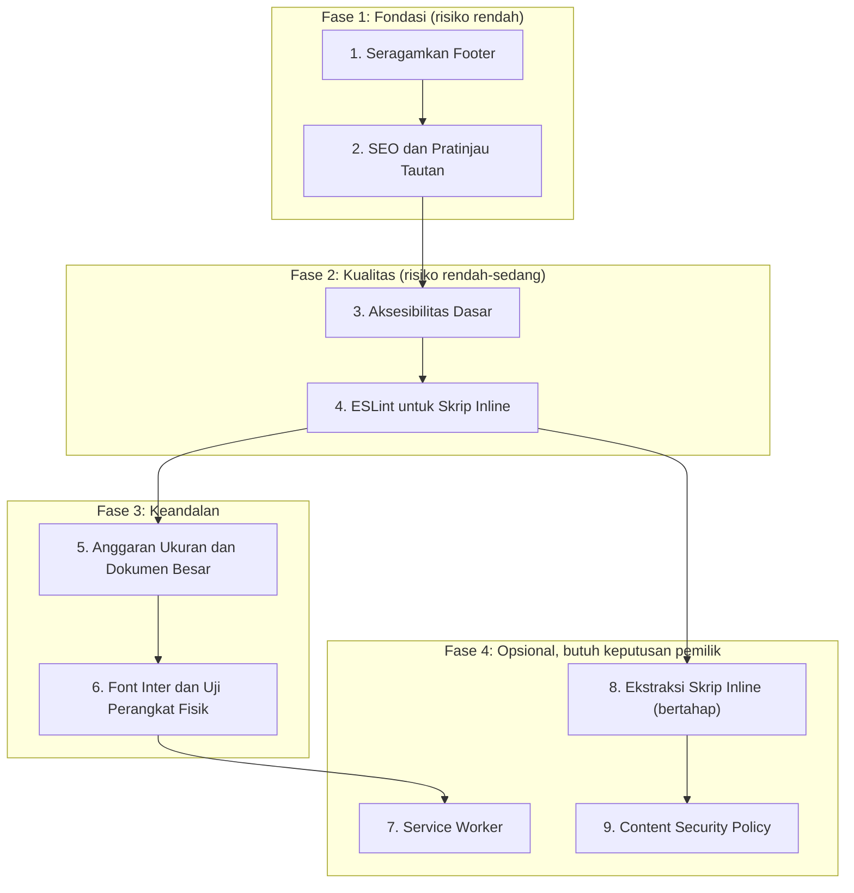

# PDF Tools — Rencana Pengembangan dan Optimalisasi

> Dokumen ini adalah peta jalan pengembangan lanjutan proyek PDF Tools,
> disusun berdasarkan audit terhadap kode, pengujian, dan arsitektur yang ada.
> Seluruh rencana tunduk pada aturan yang tercantum di `PROJECT_RULES.md` dan `AGENTS.md`.
>
> **Revisi 1 (2026-10-27):** perbaikan teknis pada butir SEO dan Service Worker, urutan baru
> berdasarkan risiko, butir baru (pemeriksaan skrip inline, font, perangkat fisik, dokumen besar,
> Content Security Policy), dan penyesuaian istilah dengan keputusan "aplikasi web saja".

---

## Ringkasan Kondisi Proyek Saat Ini

Proyek PDF Tools sudah berada dalam kondisi rilis yang stabil (v1.0.0):

| Aspek | Status |
|---|---|
| Pemrosesan di perangkat | Berkas tidak diunggah; dijaga oleh `test_no_external_urls.js` |
| Pengujian otomatis | Rangkaian test Node dan Playwright (Chromium dan WebKit); jumlah suite terbaru lihat keluaran `npm test` dan `npm run test:browser` |
| Responsif seluler | Terverifikasi lewat emulasi di lebar 360--430 px, dengan dan tanpa layar sentuh |
| Keamanan | Enkripsi AES-256, redaksi permanen, halaman yang dibuang tidak tersimpan, sanitasi tanda tangan digital |
| Dwibahasa (EN/ID) | Tombol bahasa dengan pilihan tersimpan, bawaan Inggris |
| Kualitas kode | ESLint bersih untuk berkas `.js`, ikon SVG monokrom, tanpa emoji, tanpa dialog bawaan browser |

**Tidak ada kerusakan fungsional yang harus segera diperbaiki.**
Seluruh butir di bawah ini bersifat peningkatan kualitas, bukan perbaikan darurat.

Keterbatasan yang sudah diketahui tercatat di bagian "Masalah yang Diketahui" pada `README.md`.
Dua di antaranya ditangani oleh rencana ini: belum diuji pada perangkat fisik (Butir 6) dan belum
diuji dengan dokumen besar (Butir 5).

---

## Prinsip Pelaksanaan

1. **Satu butir, satu prompt, satu sesi agent.** Jangan menjalankan dua agent (atau dua laptop)
   pada folder yang sama secara bersamaan.
2. **Angka dan daftar berkas ditentukan dari kode saat dikerjakan**, bukan disalin dari dokumen ini.
   Jumlah halaman dan suite test bisa sudah berubah.
3. **Test gagal dulu** untuk setiap perbaikan bug, keamanan, atau integritas data.
4. **Push hanya setelah** `npm test`, `npm run lint`, dan `npm run test:browser` lulus tanpa
   kegagalan dan tanpa suite yang dilewati.
5. **PDF Studio di luar cakupan**: `pages/viewer.html`, `js/studio/`, dan `js/core/pdf-studio.js`
   tidak diubah, kecuali ada izin tertulis untuk butir tertentu.
6. **Biaya dihitung dalam prompt agent dan putaran test penuh**, bukan jam kerja.

---

## Peta Butir dan Urutan



| Fase | Butir | Risiko | Perkiraan biaya agent | Catatan |
|---|---|---|---|---|
| **Fase 1** | 1. Footer, 2. SEO | Rendah | 2 prompt, 1 test penuh | Bisa dikerjakan berurutan dalam satu hari |
| **Fase 2** | 3. Aksesibilitas, 4. ESLint inline | Rendah-sedang | 3--4 prompt, 2 test penuh | Butir 4 bisa menemukan bug tersembunyi |
| **Fase 3** | 5. Ukuran dan dokumen besar, 6. Font dan perangkat | Rendah | 2 prompt, 1 test penuh, uji manual | Uji perangkat fisik dilakukan pemilik |
| **Fase 4** | 7. Service Worker, 8. Ekstraksi, 9. CSP | Sedang-tinggi | Tergantung keputusan | Kerjakan hanya setelah Fase 1--3 stabil |

> [!TIP]
> **Fase 1 dan 2 sudah memberi peningkatan terbesar** dalam konsistensi, visibilitas di mesin
> pencari, aksesibilitas, dan kualitas kode. Fase 4 boleh ditunda tanpa batas waktu.

---

## Butir 1 — Seragamkan Struktur Footer di Seluruh Halaman

### Latar Belakang

Fungsi `setupUnifiedFooter()` di `js/app.js` mengganti isi elemen `<footer class="footer">`
dengan struktur terpadu (teks, kredensial DN., tautan lisensi). Audit menemukan:

- **Halaman tanpa elemen `<footer>`** sehingga footer tidak muncul (saat audit: `page-number.html`
  dan `protect.html`).
- **Halaman dengan struktur footer lama yang kompleks** (saat audit: `crop.html`, `flatten.html`,
  `grayscale.html`, `ocr.html`). Isinya ditimpa saat runtime, tetapi isi statisnya berbeda dan
  sempat terlihat sebelum JavaScript selesai dimuat.

### Tindakan

1. Tentukan daftar halaman dari kode (`grep` elemen `<footer`), bukan dari daftar di atas.
2. Tambahkan `<footer class="footer"></footer>` pada halaman yang belum memilikinya.
3. Ganti footer kompleks dengan footer sederhana yang seragam:
   ```html
   <footer class="footer">
     <div class="container">
       <p data-i18n="footer.text">PDF Tools (DN.) — All processing is done locally in your browser.</p>
     </div>
   </footer>
   ```
4. Tambahkan pengecekan statis di `tests/` yang gagal jika ada halaman (kecuali `viewer.html`)
   tanpa `<footer class="footer">`, agar masalah ini tidak terulang.

### Kriteria Penerimaan

- Seluruh halaman standalone (kecuali `viewer.html`) menampilkan footer terpadu yang identik.
- Pengecekan statis baru lulus, dan terbukti gagal bila satu footer dihapus.
- `npm test`, `npm run lint`, dan `npm run test:browser` lulus.

### Perkiraan Cakupan

- Berkas diubah: halaman HTML yang bermasalah, 1 test baru
- Risiko: Rendah -- perubahan markup statis
- Komit: 2 (markup, test)

---

## Butir 2 — SEO Dasar dan Pratinjau Tautan

### Latar Belakang

Situs dipublikasikan di `https://danwiraza03.github.io/pdf-tools/`. Saat audit, sebagian halaman
belum memiliki `<meta name="description">`, dan seluruh halaman belum memiliki tag Open Graph,
canonical, maupun `sitemap.xml`. Akibatnya pratinjau tautan di WhatsApp, Telegram, X, dan LinkedIn
tidak informatif.

Tiga fakta teknis yang memengaruhi rancangan butir ini:

1. **Pratinjau tautan tidak mendukung gambar SVG.** `og:image` harus PNG atau JPG, idealnya
   1200 x 630 piksel, dengan alamat lengkap (absolut).
2. **`robots.txt` hanya dibaca dari akar domain** (`danwiraza03.github.io/robots.txt`), bukan dari
   subfolder `/pdf-tools/`. Karena itu `robots.txt` di proyek ini tidak berguna dan **tidak dibuat**.
   `sitemap.xml` tetap dibuat, lalu didaftarkan manual lewat Google Search Console.
3. **Tag canonical dan `og:url`/`og:image` memuat alamat lengkap `https://...`.** Ini bukan
   permintaan jaringan, tetapi `test_no_external_urls.js` kemungkinan menandainya. Test perlu
   pengecualian yang sempit, tanpa membuka celah pemuatan aset dari luar.

### Tindakan

1. **Satu sumber alamat situs.** Simpan alamat dasar (`https://danwiraza03.github.io/pdf-tools/`)
   di satu berkas konfigurasi, dan buat skrip `scripts/build_seo.js` yang menulis tag meta ke semua
   halaman serta membuat `sitemap.xml`. Jika alamat situs berubah (misalnya domain sendiri), cukup
   ubah satu tempat lalu jalankan ulang skrip.
2. **Meta description** berbahasa Inggris (150--160 karakter, memuat kata kunci alat) pada semua
   halaman yang belum memilikinya.
3. **Open Graph dan kartu X:** `og:title`, `og:description`, `og:type` (`website`), `og:url`,
   `og:image`, dan `twitter:card` (`summary_large_image`).
4. **Gambar pratinjau** `assets/og-image.png` (1200 x 630, di bawah 300 KB), dibuat dari halaman
   HTML sederhana yang dipotret dengan Playwright, tanpa alat atau layanan luar.
5. **Canonical:** `<link rel="canonical" href="[alamat lengkap halaman]">` pada setiap halaman.
6. **Pengecualian test yang sempit:** `test_no_external_urls.js` mengizinkan alamat lengkap HANYA di
   `<link rel="canonical">`, `<meta property="og:*">`, dan `<meta name="twitter:*">`, dan HANYA
   untuk alamat dasar situs sendiri. Tambahkan pembuktian bahwa `<script src="https://...">`,
   stylesheet, gambar, atau `fetch` ke domain lain tetap membuat test gagal.
7. **`viewer.html`:** dikecualikan dari butir ini, kecuali pemilik memberi izin tertulis untuk
   perubahan bagian `<head>` saja.
8. **Test SEO:** pengecekan statis bahwa setiap halaman publik punya meta description, tag Open
   Graph lengkap, canonical yang cocok dengan nama berkasnya, dan tercantum di `sitemap.xml`.

### Langkah manual pemilik

- Daftarkan `https://danwiraza03.github.io/pdf-tools/sitemap.xml` di Google Search Console.
- Uji pratinjau tautan dengan mengirim alamat situs di WhatsApp atau Telegram.

### Kriteria Penerimaan

- Semua halaman publik (kecuali `viewer.html` tanpa izin) memiliki meta description, Open Graph,
  kartu X, dan canonical yang benar.
- `assets/og-image.png` ada dan tampil sebagai pratinjau.
- `sitemap.xml` memuat semua halaman publik dan dihasilkan oleh skrip.
- `test_no_external_urls.js` lulus dan terbukti tetap menolak pemuatan aset dari domain lain.

### Perkiraan Cakupan

- Berkas baru: `scripts/build_seo.js`, berkas konfigurasi alamat, `sitemap.xml`,
  `assets/og-image.png`, 1 test
- Berkas diubah: halaman HTML publik, `test_no_external_urls.js`
- Risiko: Rendah
- Komit: 3--4 (skrip dan konfigurasi, tag di halaman, gambar pratinjau, test)

---

## Butir 3 — Aksesibilitas Dasar (a11y)

### Latar Belakang

Saat audit: belum ada tautan *skip-to-content*, landmark ARIA masih minim, belum ada region
`aria-live` untuk notifikasi, belum ada pengujian aksesibilitas otomatis, dan dialog kustom belum
mengelola fokus keyboard. Pengguna pembaca layar dan pengguna keyboard akan kesulitan.

### Tindakan

**Tahap A -- Markup semantik:**

1. Tautan *skip-to-content* di awal setiap halaman, tersembunyi secara visual tetapi terlihat saat
   mendapat fokus keyboard:
   ```html
   <a href="#main-content" class="skip-link" data-i18n="a11y.skip">Skip to content</a>
   ```
2. Elemen `<main id="main-content">` membungkus area kerja utama; `<nav>` dengan `aria-label`
   deskriptif.
3. `aria-live="polite"` pada wadah Toast agar notifikasi dibacakan.
4. `aria-label` (dwibahasa) pada semua tombol yang hanya berisi ikon SVG.
5. Label yang terhubung untuk setiap input, termasuk slider (opasitas, rotasi, ukuran).

**Tahap B -- Dialog kustom:**

6. Semua dialog (`PDFTools.Modal`, dialog password, dan dialog lain) memakai `role="dialog"`,
   `aria-modal="true"`, dan `aria-labelledby`; fokus berpindah ke dalam dialog saat dibuka, tetap
   terkunci di dalamnya, tombol Esc menutupnya, dan fokus kembali ke elemen pemicu saat ditutup.

**Tahap C -- Pengujian otomatis:**

7. Gunakan paket resmi `@axe-core/playwright`.
8. **Pendekatan dasar (baseline):** jalankan audit di semua halaman (kecuali `viewer.html`),
   simpan hasilnya di `tests/browser/a11y-baseline.json`, perbaiki pelanggaran *critical*, lalu
   test gagal hanya jika muncul pelanggaran **baru** atau jumlahnya bertambah. Baseline diperketat
   setiap kali ada perbaikan.
9. Test keyboard: Tab pertama mengenai skip-link, Esc menutup dialog, dan fokus kembali ke pemicu.

### Kriteria Penerimaan

- Navigasi keyboard logis di semua halaman standalone.
- Toast dibacakan oleh pembaca layar (`aria-live`).
- Dialog mengelola fokus sesuai Tahap B.
- Tidak ada pelanggaran *critical*; test gagal bila muncul pelanggaran baru.
- Tidak ada perubahan tampilan selain skip-link yang muncul saat fokus keyboard.

### Perkiraan Cakupan

- Berkas diubah: halaman HTML, `js/components/toast.js`, komponen dialog, `css/style.css`, kamus i18n
- Berkas baru: 1--2 test, `a11y-baseline.json`
- Risiko: Rendah-sedang (pengelolaan fokus menyentuh komponen dialog yang dipakai banyak halaman)
- Komit: 3 (Tahap A, Tahap B, Tahap C)

---

## Butir 4 — ESLint untuk Skrip Inline di HTML

### Latar Belakang

Sekitar 8.000 baris JavaScript berada di dalam tag `<script>` pada halaman HTML, dan ESLint saat ini
hanya memeriksa berkas `.js`. ESLint sudah membuktikan nilainya: ia menemukan pemakaian `Buffer`
(fitur khusus Node) yang membuat Gabung gagal di browser, padahal semua test lulus. Bug serupa bisa
tersembunyi di skrip inline.

Plugin `eslint-plugin-html` memungkinkan ESLint memeriksa skrip inline **tanpa memindahkan kode**.
Ini memberi manfaat utama Butir 8 (ekstraksi) dengan biaya dan risiko jauh lebih kecil.

### Tindakan

1. Pasang `eslint-plugin-html` dan aktifkan untuk `index.html` dan `pages/*.html`
   (kecuali `viewer.html`), dengan aturan yang sama: `no-undef` dan `no-redeclare`.
2. **Tahap laporan:** jalankan lint, laporkan jumlah temuan per halaman dan klasifikasinya
   (global sah atau bug nyata), lalu **berhenti** untuk persetujuan pemilik.
3. **Tahap perbaikan:** global sah ditambahkan ke konfigurasi (bukan mematikan aturan); bug nyata
   diperbaiki dengan test gagal dulu, satu komit per halaman.

### Kriteria Penerimaan

- `npm run lint` memeriksa skrip inline dan bersih.
- Setiap bug nyata yang ditemukan punya test yang membuktikan perbaikannya.

### Perkiraan Cakupan

- Berkas diubah: `package.json`, `eslint.config.js`, halaman dengan bug nyata (jika ada)
- Risiko: Rendah (pemeriksaan saja; perubahan kode hanya untuk bug nyata)
- Komit: 1 konfigurasi + 1 per perbaikan bug

---

## Butir 5 — Anggaran Ukuran Halaman dan Uji Dokumen Besar

### Latar Belakang

Pengukuran waktu (detik) berbeda-beda antara laptop dan server, sehingga test berbasis waktu sering
gagal tanpa sebab yang jelas. Ukuran unduhan dan jumlah permintaan per halaman bersifat pasti dan
lebih cocok untuk menangkap regresi. Selain itu, aplikasi belum pernah diuji dengan dokumen besar.

### Tindakan

1. **Anggaran ukuran** di `test_page_weight.js` yang sudah ada: catat ukuran unduhan dan jumlah
   permintaan saat ini per halaman, tetapkan batas = angka sekarang + 20%, dan gagalkan test jika
   terlampaui. OCR diukur tanpa model bahasa (model dimuat saat dibutuhkan).
2. **Uji dokumen besar** di `tests/browser/test_large_documents.js`, dijalankan lewat perintah
   terpisah `npm run test:large` (tidak masuk `test:browser`): fixture dibuat di dalam test
   (ratusan halaman, dan satu berkas puluhan MB berisi gambar) untuk Gabung, Pisah, Kompres,
   Watermark, dan Hapus Halaman. Verifikasi hasil benar dan tidak ada galat; catat waktu dan memori
   sebagai laporan, bukan syarat lulus.
3. **Waktu pemrosesan** (gabung 10 PDF, kompres 10 halaman foto, pratinjau halaman pertama)
   dicatat sebagai laporan di `npm run test:large`, tidak menggagalkan test.
4. **Dokumentasikan angka dasar** di `docs/PERFORMANCE.md`.

### Kriteria Penerimaan

- Anggaran ukuran aktif di `npm run test:browser` dan terbukti gagal bila batas dilampaui.
- `npm run test:large` berjalan dan menghasilkan laporan.
- Jika dokumen besar memicu masalah nyata, masalah itu dicatat di "Masalah yang Diketahui" atau
  diperbaiki dalam butir terpisah.

### Perkiraan Cakupan

- Berkas baru: `test_large_documents.js`, `docs/PERFORMANCE.md`
- Berkas diubah: `test_page_weight.js`, `package.json`
- Risiko: Rendah (pengujian saja)
- Komit: 2

---

## Butir 6 — Font Inter dan Uji Perangkat Fisik

### Latar Belakang

CSS meminta font Inter, tetapi berkas fontnya tidak disertakan, sehingga setiap sistem memakai font
cadangan yang berbeda. Inilah penyebab utama bug tombol menu keluar layar di lebar 390 px yang lolos
di Windows tetapi gagal di Linux. Selain itu, aplikasi belum pernah diuji pada HP sungguhan.

### Tindakan

1. **Sertakan Inter** (format woff2, subset Latin dan Latin Extended, hanya ketebalan yang dipakai
   CSS) di `fonts/`, dengan `@font-face` dan `font-display: swap`. Tambahkan lisensinya (SIL Open
   Font License) ke `THIRD_PARTY_NOTICES.md` dan perbarui anggaran ukuran dari Butir 5.
2. Pastikan test header seluler (termasuk mode "font lebar") tetap lulus.
3. **Uji perangkat fisik (dilakukan pemilik)** dengan daftar periksa di `docs/DEVICE_TESTING.md`:
   iPhone Safari dan Android Chrome; skenario Gabung lalu unduh hasil, Watermark gambar dari galeri,
   Tanda Tangan, OCR lewat jaringan seluler, Kompres 20 halaman, menu hamburger, dan PDF terproteksi.
   Catat model HP, versi browser, dan hasilnya.
4. Setelah uji perangkat lulus, hapus baris "Belum diuji pada perangkat fisik" dari `README.md`.

### Kriteria Penerimaan

- Tampilan teks seragam di Windows, Linux, dan HP (diperiksa lewat test header dan tangkapan layar).
- `docs/DEVICE_TESTING.md` berisi hasil uji minimal satu iPhone dan satu Android.

### Perkiraan Cakupan

- Berkas baru: berkas font, `docs/DEVICE_TESTING.md`
- Berkas diubah: CSS font, `THIRD_PARTY_NOTICES.md`, `README.md`
- Risiko: Rendah
- Komit: 2 (font, dokumentasi uji perangkat)

---

## Butir 7 — Service Worker (opsional, butuh keputusan pemilik)

### Latar Belakang

Service Worker (SW) memungkinkan kunjungan ulang dimuat dari cache dan aplikasi dipakai tanpa
internet. `sw.js` lama dihapus karena tidak pernah didaftarkan (kode mati), bukan karena SW dilarang.
Namun SW adalah butir paling berisiko: kesalahan konfigurasi bisa membuat pengunjung tertahan di
versi lama atau mendapat campuran berkas lama dan baru.

### Keputusan yang dibutuhkan sebelum mulai

- Apakah kemampuan offline memang dibutuhkan pengguna situs ini?
- Pemilik menerima bahwa setiap rilis harus menyertakan pembaruan versi cache (dibuat otomatis oleh skrip).

### Rancangan

1. **Cache awal hanya kerangka aplikasi** (HTML, CSS, JS inti) dengan batas ukuran yang diuji
   (misalnya maksimal 5 MB). **Jangan** menyimpan semua aset di kunjungan pertama: total aset
   sekitar 55 MB termasuk model OCR, dan itu akan membatalkan manfaat pemuatan OCR saat dibutuhkan.
   Model OCR dan pustaka berat PDF Studio disimpan ke cache hanya setelah benar-benar dipakai.
2. **Versi cache otomatis.** Nama berkas di proyek ini tidak berubah antar versi, sehingga strategi
   *cache-first* biasa berbahaya. Skrip `scripts/build_sw_manifest.js` menghasilkan daftar berkas
   beserta hash isinya; versi cache diturunkan dari hash itu. Test gagal jika ada berkas yang
   berubah tetapi daftar belum diperbarui.
3. **Strategi:** HTML *network-first* dengan cadangan cache; aset statis dilayani dari cache versi
   yang sama dengan HTML-nya; cache versi lama dihapus saat SW baru aktif.
4. **Pemberitahuan pembaruan:** saat versi baru siap, tampilkan Toast dwibahasa "Versi baru
   tersedia" dengan tombol muat ulang. Jangan mengganti versi secara diam-diam di tengah sesi.
5. **Privasi:** SW hanya menyimpan permintaan GET ke berkas statis milik situs sendiri di bawah
   `/pdf-tools/`. **Tidak pernah** menyimpan berkas PDF pengguna, hasil olahan, `blob:`, `data:`,
   atau permintaan ke domain lain. Diverifikasi oleh test yang memeriksa isi Cache Storage.
6. **Jalan mundur:** siapkan versi `sw.js` "pemutus" yang menghapus semua cache dan membatalkan
   pendaftarannya sendiri, terdokumentasi di `README.md`, untuk dipakai jika SW bermasalah.
7. **Ikon PWA:** `icons/icon-192.png` dan `icons/icon-512.png` dibuat dari `icon.svg` lewat Playwright,
   lalu `manifest.json` diperbarui.
8. Perbarui `check_repo_hygiene.js` agar `sw.js` diizinkan.

### Kriteria Penerimaan

- Halaman yang sudah dikunjungi dapat dimuat ulang dalam mode offline Chromium.
- Ukuran cache awal di bawah batas yang ditetapkan; model OCR tidak ikut tersimpan sebelum dipakai.
- Test pembaruan: setelah versi berubah, pemberitahuan muncul dan muat ulang memakai versi baru
  tanpa campuran berkas lama.
- Test privasi Cache Storage dan `test_no_external_urls.js` lulus.

### Perkiraan Cakupan

- Berkas baru: `sw.js`, `scripts/build_sw_manifest.js`, ikon PNG, 2--3 test
- Berkas diubah: `js/app.js`, `manifest.json`, `check_repo_hygiene.js`, kamus i18n, `README.md`
- Risiko: **Sedang-tinggi**
- Komit: 4--5

---

## Butir 8 — Ekstraksi Skrip Inline (bertahap, sambil lalu)

### Latar Belakang

Skrip inline yang besar (terbesar: `merge.html`, `sign.html`, `watermark.html`, `ocr.html`) membuat
pemeliharaan lebih sulit. Setelah Butir 4, manfaat pemeriksaan lint sudah didapat tanpa ekstraksi,
sehingga butir ini tidak mendesak.

### Tindakan

1. **Tidak dikerjakan sebagai proyek besar.** Skrip suatu halaman dipindahkan hanya ketika halaman
   itu sedang diubah untuk keperluan lain.
2. Lokasi: `js/pages/[nama-halaman].js` untuk logika tampilan, terpisah dari mesin pemrosesan di
   `js/core/`. Isi dibungkus fungsi agar tidak menambah nama global
   (dijaga oleh `check_global_collisions.js`).
3. Setiap ekstraksi diikuti seluruh rangkaian test; perilaku harus identik.
4. Catat kemajuan di tabel kecil pada dokumen ini.

### Kriteria Penerimaan

- Halaman yang diekstraksi memuat `<script src="../js/pages/...">` dan perilakunya identik.
- Lint dan pemeriksaan tabrakan nama global tetap bersih.

### Perkiraan Cakupan

- Per halaman: 1 berkas baru, 1 halaman diubah, 1 komit
- Risiko: Sedang per halaman (lingkup variabel, *event listener*, rujukan DOM)

| Halaman | Berkas Skrip | Status |
|---|---|---|
| `pages/remove-pages.html` | `js/pages/remove-pages.js` | ✅ Selesai (Fase 1) |
| `pages/reorder.html` | `js/pages/reorder.js` | ✅ Selesai (Fase 1) |
| `pages/jpg-to-pdf.html` | `js/pages/jpg-to-pdf.js` | ✅ Selesai (Fase 1) |
| `pages/pdf-to-docx.html` | `js/pages/pdf-to-docx.js` | ✅ Selesai (Fase 2) |
| `pages/docx-to-pdf.html` | `js/pages/docx-to-pdf.js` | ✅ Selesai (Fase 2) |
| `pages/pdf-to-xlsx.html` | `js/pages/pdf-to-xlsx.js` | ✅ Selesai (Fase 2) |
| `pages/xlsx-to-pdf.html` | `js/pages/xlsx-to-pdf.js` | ✅ Selesai (Fase 2) |
| `pages/pdf-to-jpg.html` | `js/pages/pdf-to-jpg.js` | ✅ Selesai (Fase 2) |
| `pages/rotate.html` | `js/pages/rotate.js` | ✅ Selesai (Fase 3) |
| `pages/flatten.html` | `js/pages/flatten.js` | ✅ Selesai (Fase 3) |
| `pages/split.html` | `js/pages/split.js` | ✅ Selesai (Fase 3) |
| `pages/crop.html` | `js/pages/crop.js` | ✅ Selesai (Fase 3) |
| `pages/grayscale.html` | `js/pages/grayscale.js` | ✅ Selesai (Fase 3) |
| `pages/protect.html` | `js/pages/protect.js` | ✅ Selesai (Fase 4) |
| `pages/page-number.html` | `js/pages/page-number.js` | ✅ Selesai (Fase 4) |
| `pages/batch.html` | `js/pages/batch.js` | ✅ Selesai (Fase 4) |
| `pages/compress.html` | `js/pages/compress.js` | ✅ Selesai (Fase 4) |

---

## Butir 9 — Content Security Policy (opsional)

### Latar Belakang

Content Security Policy (CSP) melalui tag `<meta http-equiv="Content-Security-Policy">` membatasi
dari mana skrip, gambar, dan koneksi boleh dimuat. Ini lapisan perlindungan tambahan yang murah,
tetapi baru bisa ketat setelah skrip inline berkurang (Butir 8). Pustaka OCR dan PDF.js memakai
worker dan WebAssembly, sehingga kebijakan harus diuji dengan cermat.

### Tindakan

1. Mulai dari kebijakan yang hanya mengizinkan sumber dari situs sendiri (`'self'`) ditambah
   `blob:` dan `data:` di tempat yang memang dibutuhkan (worker, gambar, unduhan), `object-src 'none'`,
   dan `base-uri 'self'`. Selama skrip inline masih ada, `'unsafe-inline'` untuk skrip masih
   diperlukan; catat sebagai utang yang dilunasi oleh Butir 8.
2. Test browser memantau peristiwa `securitypolicyviolation` di semua halaman dan alur utama
   (termasuk OCR dan PDF Studio jika diizinkan) dan gagal bila ada pelanggaran.

### Kriteria Penerimaan

- Semua halaman dan alur utama berjalan tanpa pelanggaran CSP.
- Pemuatan skrip dari domain lain terbukti ditolak browser.

### Perkiraan Cakupan

- Berkas diubah: semua halaman HTML (satu tag meta), 1 test baru
- Risiko: Sedang (worker OCR dan PDF.js sensitif terhadap kebijakan)
- Komit: 2

---

## Di Luar Cakupan Rencana Ini

- **Peningkatan PDF Studio** (dukungan layar sentuh, penanganan PDF berproteksi, bawaan OCR
  `ind+eng`): dikecualikan oleh aturan proyek sampai ada keputusan terpisah.
- **Penghapusan aset OCR cadangan** (sekitar 27 MB): aset ini dipakai jalur cadangan OCR, jadi
  penghapusannya butuh keputusan dan pengujian tersendiri.

---

## Batasan yang Harus Dipatuhi (dari PROJECT_RULES.md)

Seluruh butir di atas **wajib** mematuhi aturan berikut:

1. **Pemrosesan 100% di perangkat** -- berkas pengguna tidak pernah diunggah atau diproses di server.
2. **Tanpa pemuatan dari domain lain** -- tidak ada skrip, font, gambar, atau permintaan jaringan ke
   domain lain. Pengecualian satu-satunya adalah alamat situs sendiri di tag canonical, Open Graph,
   dan kartu X (Butir 2), yang dijaga oleh test.
3. **Larangan Emoji** -- semua ikon memakai inline SVG `viewBox="0 0 24 24"`.
4. **Dwibahasa Wajib** -- teks baru harus ada di kamus `en` dan `id`.
5. **Lint Bersih** -- `npm run lint` lulus tanpa temuan sebelum setiap komit.
6. **Tidak Mengubah** `pages/viewer.html`, `js/studio/`, dan `js/core/pdf-studio.js` tanpa izin tertulis.
7. **Struktur 6 Bagian** -- halaman standalone mengikuti anatomi Header-Hero-Dropzone-Workspace-ActionBar-Result.
8. **Pengujian Hasil Nyata** -- test memverifikasi hasil (isi PDF, piksel, struktur berkas), bukan
   sekadar keberadaan fungsi.
9. **Satu agent dalam satu waktu** dan push hanya setelah seluruh test lulus.

---

## Keputusan yang Dibutuhkan dari Pemilik

| Keputusan | Butir | Bawaan bila belum diputuskan |
|---|---|---|
| Izin mengubah `<head>` di `viewer.html` | 2 | Tidak diubah |
| Desain gambar pratinjau tautan | 2 | Logo dan nama aplikasi di latar polos |
| Apakah kemampuan offline (Service Worker) dibutuhkan | 7 | Tidak dikerjakan |
| Waktu uji perangkat fisik | 6 | Setelah Fase 2 selesai |
