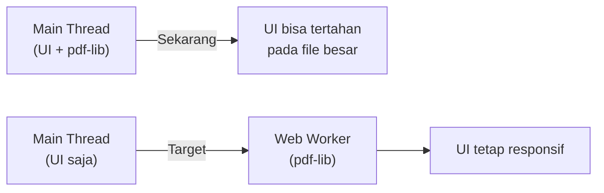
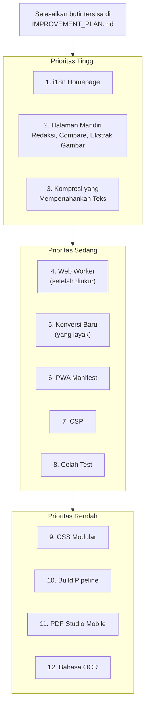

# PDF Tools — Peta Jalan Pengembangan

Hasil audit terhadap 23 alat, 94 file JS (34.914 baris), dan 27 suite test browser. Angka ini
per waktu audit; perbarui dari kode bila berubah.

> [!NOTE]
> Diurutkan berdasarkan dampak terhadap pengguna dan kelayakan teknis. Prioritas **Tinggi** bisa
> dikerjakan segera, **Sedang** dalam iterasi berikutnya, **Rendah** bersifat aspiratif.
>
> **Revisi 1 (koreksi):** beberapa klaim audit dikoreksi setelah dicocokkan dengan kode (lihat
> bagian "Catatan Verifikasi" di akhir). Urutan diubah: kompresi yang mempertahankan teks naik ke
> prioritas Tinggi, Web Worker turun ke Sedang (perlu diukur dulu), dan beberapa konversi dinilai
> ulang kelayakannya untuk aplikasi yang memproses semua berkas di browser.

---

## Hubungan dengan IMPROVEMENT_PLAN.md

Roadmap ini **melanjutkan** `IMPROVEMENT_PLAN.md`, bukan menggantikannya. Sebelum memulai butir di
sini, periksa status butir di rencana itu. Yang belum selesai sebaiknya didahulukan, terutama:

- **Uji dokumen besar** (Butir 5 rencana): menghasilkan data yang dibutuhkan butir Web Worker di sini.
- **Uji perangkat fisik** (Butir 6 rencana): masih tercatat sebagai keterbatasan di README.
- **Aksesibilitas, SEO, dan ESLint untuk skrip inline** (Butir 2--4 rencana): semua halaman baru di
  roadmap ini wajib memenuhinya.

Prinsip pelaksanaan di rencana itu tetap berlaku: satu butir per prompt dan satu agent dalam satu
waktu, test gagal dulu untuk setiap perbaikan, push hanya setelah seluruh test lulus, dan PDF Studio
(`pages/viewer.html`, `js/studio/`, `js/core/pdf-studio.js`) tidak diubah tanpa izin tertulis.

---

## Prioritas Tinggi

### 1. Kelengkapan i18n Homepage (sekitar 30 string belum diterjemahkan)

Sekitar 30 elemen UI di homepage masih *hardcoded* bahasa Inggris tanpa atribut `data-i18n`:

| Lokasi | Contoh |
|---|---|
| Deskripsi kartu alat (`.tool-card-desc`) | 21 deskripsi alat |
| Label pil kategori filter | "All", "Workflows", "Organize PDF" |
| Header kolom mega menu | "ORGANIZE PDF", "OPTIMIZE PDF" |
| Tombol Cancel di Quick Modal | "Cancel" |
| Label "Batch Process" | hardcoded |
| Link footer | "License (MIT)", "Third-Party Notices" |

**Dampak**: pengguna yang memilih bahasa Indonesia melihat campuran bahasa.
**Usaha**: Rendah, hanya menambahkan kunci i18n dan atribut `data-i18n`.
**Tambahan**: buat pengecekan statis yang gagal bila ada teks terlihat di homepage, header, dan mega
menu tanpa `data-i18n` (dengan daftar pengecualian tertulis, misalnya nama merek "PDF Tools (DN.)"),
agar masalah ini tidak terulang.

### 2. Halaman Mandiri untuk Mesin yang Sudah Ada

Beberapa mesin pemrosesan sudah ada di `js/editor/`, tetapi **saat ini hanya dimuat oleh PDF Studio**
(`viewer.html`), sehingga tidak bisa ditemukan pengguna sebagai alat mandiri:

| Modul | Halaman yang diusulkan | Prioritas |
|---|---|---|
| `redaction-engine.js` | `pages/redact.html` — Redaksi mandiri | Tinggi (fitur keamanan yang sudah teruji) |
| `compare-engine.js` | `pages/compare.html` — Bandingkan dua PDF secara visual | Tinggi |
| `image-extractor.js` | `pages/extract-images.html` — Ekstrak gambar dari PDF | Tinggi (sebelumnya dicatat sebagai "konversi yang belum ada", padahal mesinnya sudah ada) |
| `page-tools-engine.js` (Bates) | Digabung ke Page Numbers | Sedang |
| `accessibility-engine.js` | `pages/accessibility-check.html` — Pemeriksaan aksesibilitas dasar | Sedang |

**Syarat sebelum membuat UI:**

1. **Pastikan mesinnya berdiri sendiri.** Karena selama ini hanya dipakai di dalam Studio, periksa
   ketergantungan pada state, DOM, atau global milik Studio. Tulis test Node atau browser untuk mesin
   itu sendiri sebelum membangun halaman.
2. **Perbaikan pada mesin** di `js/editor/` juga memengaruhi PDF Studio. Setiap perubahan mesin wajib
   diikuti test regresi Studio yang sudah ada.
3. **Halaman baru mengikuti standar proyek:** anatomi 6 bagian, dwibahasa, footer terpadu, tag SEO,
   baseline aksesibilitas, komponen seret-lepas berkas, pemuatan PDF terproteksi
   (`loadPdfDecrypted`), dan sanitasi tanda tangan digital bila berkas ditulis ulang.
4. **Redaksi mandiri** wajib memakai jalur yang sama dengan Studio (rasterisasi halaman yang ditandai
   dan pembuangan objek tersembunyi) dan lulus test kebocoran yang sudah ada
   (`test_redaction_rasterize.js`).
5. **Pemeriksaan aksesibilitas** diberi label "pemeriksaan dasar", **bukan** sertifikasi PDF/UA,
   karena kepatuhan penuh butuh validator khusus. Hasilnya jangan sampai menyesatkan pengguna.

**Dampak**: fitur yang sudah dibangun menjadi bisa ditemukan dan dipakai.

### 3. Kompresi yang Mempertahankan Teks

Mode "Extreme" dan "Recommended" saat ini **merasterisasi halaman menjadi gambar**, sehingga teks
tidak bisa diseleksi atau dicari lagi. Ini tercatat sebagai keterbatasan di README dan menyentuh alat
inti, sehingga naik ke prioritas Tinggi.

Langkah yang disarankan, dari yang paling berdampak:

1. **Mode baru "Seimbang": perkecil gambar tertanam saja.** Gambar di dalam PDF diperkecil resolusinya
   dan di-encode ulang, sedangkan teks dan grafik vektor tetap utuh. Ini paling berdampak untuk PDF
   berisi foto. Perhatikan gambar bermasker (SMask), ruang warna CMYK, dan gambar yang dipakai ulang
   di beberapa halaman.
2. **Kompresi ulang stream** dan penyimpanan dengan object streams.
3. **Lapisan teks OCR setelah rasterisasi** (opsional untuk mode Extreme): memulihkan teks yang bisa
   dicari, tetapi lambat dan mengunduh model OCR.
4. **Subsetting font**: dampaknya kecil untuk kebanyakan PDF dan butuh pustaka pengolah font. Prioritas
   Rendah.

**Test**: setelah kompresi mode baru, teks tetap bisa diekstrak (PDF.js), rasio pengecilan pada PDF
foto tercatat, dan tampilan halaman tetap mirip secara piksel dalam batas toleransi.

---

## Prioritas Sedang

### 4. Web Worker untuk Pemrosesan pdf-lib

**Koreksi:** tidak semua pemrosesan berjalan di *main thread*. OCR (Tesseract) dan render PDF.js
**sudah** memakai worker. Yang masih di *main thread* adalah pemrosesan berbasis pdf-lib
(gabung, watermark, kompres, flatten, dan sejenisnya).

**Ukur dulu**: jalankan uji dokumen besar (Butir 5 di `IMPROVEMENT_PLAN.md`) untuk memastikan alat
mana yang benar-benar membuat UI tertahan dan pada ukuran berapa. Kerjakan butir ini hanya jika
datanya menunjukkan masalah nyata.

**Kandidat pertama**: `pdf-merge.js`, karena hanya memakai pdf-lib tanpa DOM. Alat yang memakai canvas
(kompres, flatten) butuh `OffscreenCanvas` di worker, dan dukungannya di Safari perlu diperiksa.

**Syarat**: data dipindahkan dengan *transferable* `ArrayBuffer` agar tidak tergandakan; progres,
pembatalan, dan pesan galat tetap berfungsi; dialog password tetap di *main thread*; ada cadangan ke
*main thread* bila worker tidak tersedia. Catatan: worker membuat UI responsif, tetapi **tidak**
mengurangi kebutuhan memori.

**Risiko**: Sedang-tinggi. **Dampak**: UX lebih baik untuk file besar, terutama di HP.

### 5. Konversi Baru

Penilaian ulang berdasarkan kelayakan di browser, tanpa server dan tanpa permintaan ke domain lain:

| Fitur | Kelayakan | Catatan |
|---|---|---|
| Ekstrak gambar dari PDF | Tinggi | Mesin sudah ada (`image-extractor.js`), lihat Butir 2 |
| PDF ke PowerPoint | Sedang | Versi awal realistis: setiap halaman menjadi slide berupa gambar. Teks yang bisa diedit jauh lebih sulit |
| Perbaiki PDF rusak | Rendah-sedang | Hanya kerusakan ringan yang bisa dipulihkan; pesan ke pengguna harus jujur |
| HTML ke PDF | Rendah | Hanya untuk berkas HTML lokal; mengambil halaman web dari internet melanggar aturan tanpa permintaan luar |
| PDF/A (arsip) | Rendah | Kepatuhan butuh validasi khusus; jangan mengklaim "PDF/A" tanpa bisa membuktikannya |
| PowerPoint ke PDF | Tidak disarankan | Merender PowerPoint dengan akurat di browser tidak realistis tanpa mesin render kantor |

Perbandingan fitur dengan iLovePDF, Smallpdf, dan Adobe dihapus dari dokumen ini karena belum
diverifikasi dan fitur kompetitor sering berubah. Jika dibutuhkan, verifikasi langsung di situs mereka.

**Syarat pustaka baru**: disertakan di `js/lib/` (tidak dimuat dari luar), lisensinya dicatat di
`THIRD_PARTY_NOTICES.md` dan `js/lib/VENDORS.md`, dan ukurannya masuk anggaran halaman.

### 6. PWA Manifest — Shortcuts dan Screenshots

File `manifest.json` saat ini belum punya:

- **`shortcuts`**: pintasan langsung ke alat populer (Gabung, Kompres, Tanda Tangan) dari ikon aplikasi.
  Alamatnya relatif terhadap lingkup `/pdf-tools/`.
- **`screenshots`**: tangkapan layar untuk dialog pemasangan, dibuat dengan Playwright.
- **`description`** dalam bahasa Inggris, sesuai bahasa bawaan situs.
- **`lang`** dan **`dir`**.

**Catatan**: manfaatnya bergantung pada apakah situs bisa dipasang sebagai aplikasi di browser
pengguna. Periksa kriteria pemasangan browser utama, dan kaitkan dengan keputusan Service Worker di
`IMPROVEMENT_PLAN.md` (Butir 7).

**Dampak**: pengalaman pemasangan yang lebih profesional. **Usaha**: Rendah.

### 7. Pengetatan Content Security Policy (CSP)

Pastikan dulu CSP memang sudah terpasang di semua halaman. Pada salinan kode terakhir yang diperiksa,
belum ada tag CSP.

Langkah pengetatan:

- **Pindahkan skrip inline ke berkas eksternal** (Butir 8 di `IMPROVEMENT_PLAN.md`), termasuk
  atribut *event handler* inline seperti `onclick="..."`.
- **Gunakan hash, bukan nonce**, untuk skrip yang masih harus inline. Nonce harus unik di setiap
  respons server, sehingga tidak bisa dipakai di situs statis seperti GitHub Pages.
- **Hapus `'unsafe-eval'` bila memungkinkan**: PDF.js punya opsi `isEvalSupported: false` (saat ini
  belum diset). Mesin OCR berbasis WebAssembly kemungkinan cukup dengan `'wasm-unsafe-eval'`. Keduanya
  harus dibuktikan lewat test.
- **Test**: pantau peristiwa `securitypolicyviolation` di semua halaman dan alur utama.

### 8. Test untuk Celah yang Belum Tertutup

**Koreksi:** beberapa test yang disebut belum ada ternyata **sudah** ada:
`test_compress_effectiveness.js` (rasio kompresi per mode), serta `test_watermark_image.js`,
`test_watermark_rotation_opacity.js`, dan `test_watermark_preview.js` (posisi, opasitas, dan
rotasi diverifikasi per piksel).

Celah yang masih perlu ditutup:

- `pdf-to-docx.js` dan `pdf-to-xlsx.js`: struktur dan isi hasil konversi (teks, urutan, tabel).
- `docx-to-pdf` dan `xlsx-to-pdf`: isi teks hasil konversi.
- `pdf-crop.js`: ketepatan pemangkasan otomatis ruang kosong.
- Mesin di `js/editor/` yang akan dipakai halaman baru (Butir 2).

---

## Prioritas Rendah (Aspiratif)

### 9. CSS — Modularisasi dan Minifikasi

| File | Baris | Catatan |
|---|---:|---|
| `css/style.css` | 3.150 | Global dan tema |
| `css/tool.css` | 2.331 | Semua halaman alat |
| `css/home.css` | 652 | Homepage |

**Catatan kelayakan**: proyek ini tidak punya langkah build, dan situs dipublikasikan langsung dari
branch. Minifikasi berarti menyimpan berkas hasil minifikasi di repositori atau mengganti cara
publikasi. GitHub Pages juga sudah memampatkan berkas teks saat dikirim, sehingga penghematan nyatanya
kemungkinan hanya puluhan KB. **Ukur dulu** lewat anggaran ukuran halaman sebelum memutuskan.
Pemisahan CSS per fitur boleh dilakukan bertahap bila memang mengurangi ukuran yang dimuat.

### 10. Build Pipeline (Bundler)

Saat ini semua skrip dimuat lewat tag `<script>` manual (lebih dari 30 di `viewer.html`).

| Aspek | Sekarang | Dengan Bundler |
|---|---|---|
| Minifikasi JS | Tidak ada | Lebih kecil (sebagian sudah diimbangi kompresi GitHub Pages) |
| Tree-shaking | Tidak ada | Buang kode mati |
| Urutan skrip | Manual, rapuh | Otomatis dari import |
| Source maps | Tidak ada | Debug lebih mudah |

**Prasyarat keputusan**: cara publikasi (tetap dari branch dengan hasil build ikut di-commit, atau
pindah ke publikasi lewat Actions), migrasi arsitektur IIFE dan `window.PDFTools`, serta dampaknya ke
PDF Studio. Ini refaktor besar dengan risiko tinggi; tidak disarankan dalam waktu dekat.

### 11. PDF Studio untuk Mobile

PDF Studio (`pages/viewer.html`) saat ini hanya optimal untuk desktop (mouse events). Butir ini **butuh
pencabutan aturan "PDF Studio tidak diubah"** sebelum dikerjakan.

- Ganti mouse events dengan pointer events.
- Implementasi pinch-to-zoom dan gestur geser.
- Toolbar responsif dengan laci samping.
- **Ini proyek besar**; mungkin lebih baik sebagai "PDF Studio Lite" terpisah.

### 12. Bahasa OCR Tambahan

Saat ini hanya **Indonesia** dan **Inggris**. Langkah realistis:

- Tambahkan beberapa bahasa populer Asia Tenggara (Melayu, Thai, Vietnam, Tagalog).
- Lazy-load data bahasa saat dipilih (infrastrukturnya sudah ada).
- **Koreksi ukuran**: di proyek ini model disimpan sebagai berkas JS (base64). Model Indonesia sekitar
  5 MB dan Inggris sekitar 14,6 MB, jadi setiap bahasa tambahan bisa menambah beberapa MB sampai lebih
  dari 10 MB ke repositori dan situs. Pertimbangkan model versi ringan (akurasi sedikit lebih rendah).
- Catat lisensi data model (Apache-2.0) di `THIRD_PARTY_NOTICES.md`, dan uji akurasi per bahasa,
  terutama bahasa dengan aksara non-Latin seperti Thai.

---

## Ringkasan Prioritas

> [!TIP]
> Tiga perubahan berdampak besar dengan usaha kecil: **i18n homepage**, **manifest PWA**
> (deskripsi, bahasa, shortcuts), dan **halaman Redaksi mandiri** (mesin dan test kebocorannya sudah
> ada). Halaman Compare dan Ekstrak Gambar menyusul setelah mesinnya terbukti berjalan di luar PDF Studio.

---

## Catatan Verifikasi

Klaim audit yang dikoreksi setelah dicocokkan dengan kode:

| Klaim awal | Hasil pemeriksaan |
|---|---|
| Semua pemrosesan berat di *main thread* | OCR dan render PDF.js sudah memakai worker; yang di *main thread* adalah pdf-lib |
| Ekstrak gambar termasuk konversi yang belum ada | Mesin `js/editor/image-extractor.js` sudah ada |
| Tidak ada test rasio kompresi dan piksel watermark | Sudah ada (`test_compress_effectiveness.js` dan tiga test watermark) |
| CSP sudah memakai `'unsafe-inline'` dan `'unsafe-eval'` | Tidak ditemukan tag CSP pada salinan kode terakhir yang diperiksa; pastikan ulang di kode terbaru |
| Nonce untuk skrip inline | Tidak bisa dipakai di situs statis; gunakan hash |
| Ukuran per bahasa OCR sekitar 1--4 MB | Di proyek ini sekitar 5--14,6 MB per bahasa |
| Perbandingan fitur kompetitor | Belum diverifikasi; dihapus |
| Mesin di `js/editor/` siap dipakai | Saat ini hanya dimuat oleh PDF Studio; kemandiriannya perlu dibuktikan dengan test |
