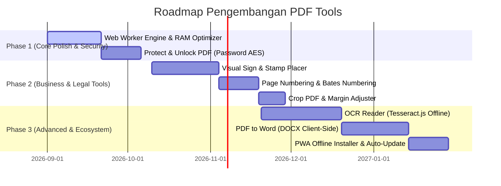

# 📊 PRODUCT MANAGEMENT REPORT & DEVELOPMENT ROADMAP
**Software Name:** PDF Tools (Desktop & Standalone Web)  
**Version:** 1.2.0 (Active Release)  
**Architecture:** Client-Side Zero-Server (JavaScript + PDF-Lib + PDF.js + Electron)  
**Target Market:** Pengguna Individual, Korporat, Perbankan/Legal, dan Instansi yang membutuhkan privasi dokumen 100% tanpa upload ke cloud.  
**Author / Role:** Project Manager & Lead Product Architect  
**Last Updated:** Agustus 2026  

---

## 1. 📌 Executive Summary (Ringkasan Eksekutif)

Software **PDF Tools** saat ini telah berhasil mencapai fase *Production-Ready MVP+* dengan keunggulan diferensiasi yang sangat kuat dibandingkan kompetitor cloud komersial (seperti iLovePDF atau Smallpdf):

1. **100% Client-Side & Private:** Dokumen sensitif tidak pernah diunggah ke server pihak ketiga manapun. Memenuhi standar kepatuhan privasi (GDPR/UU Perlindungan Data Pribadi) untuk data rahasia perusahaan.
2. **Hybrid Architecture:** Berjalan fleksibel baik sebagai aplikasi Desktop Native (`.exe` via Electron) maupun web statis murni tanpa backend.
3. **Smart Indonesian Context:** Mampu menangani dokumen resmi Indonesia (E-Materai 10000 & Tanda Tangan Digital) tanpa merusak atau menghilangkan elemen visual stempel/materai saat di-compress atau di-merge.
4. **Organize-Centric UX:** Fitur penggabungan (Merge) langsung terintegrasi dengan visual page organizer (drag-and-drop, rotasi, eliminasi lembar halaman).

---

## 2. 🔍 Analisa SWOT (Kondisi Saat Ini)

```
┌──────────────────────────────────────────┬──────────────────────────────────────────┐
│ STRENGTHS (Kekuatan)                     │ WEAKNESSES (Kelemahan)                   │
├──────────────────────────────────────────┼──────────────────────────────────────────┤
│ • Tanpa biaya server/kuota (Zero-Cost).  │ • Pemrosesan di UI Thread (bisa lag jika │
│ • Privasi mutlak (Offline-First).        │   file >100MB / >500 halaman).           │
│ • Dukungan Dual Theme (Dark/Light).      │ • Belum ada fitur OCR (Searchable PDF).  │
│ • Mesin kompresi adaptif (Vector/Raster).│ • Konversi terbatas (belum ada ke Word). │
│ • Tampilan modern & intuitif.            │ • Belum ada fitur proteksi sandi/enkripsi│
├──────────────────────────────────────────┼──────────────────────────────────────────┤
│ OPPORTUNITIES (Peluang)                  │ THREATS (Tantangan)                      │
├──────────────────────────────────────────┼──────────────────────────────────────────┤
│ • Kebutuhan B2B untuk dokumen kontrak.   │ • Batasan memori RAM browser pada file   │
│ • Fitur Stempel & E-Materai Placer.      │   skala raksasa (500MB+).                │
│ • Menjadi utilitas internal perusahaan.  │ • Variasi format PDF non-standar (XFA).  │
└──────────────────────────────────────────┴──────────────────────────────────────────┘
```

---

## 3. 🎯 Gap Analysis per Modul (Kondisi Saat Ini vs Target Ideal)

| Modul | Kondisi Saat Ini (As-Is) | Target Pengembangan (To-Be) | Tingkat Urgensi |
|---|---|---|:---:|
| **Merge PDF** | Mendukung drag-drop halaman, rotasi, delete lembar, dan e-materai safe. | Tambahkan fitur *Duplicate Page*, *Split File Grouping*, dan *Zoom Preview modal*. | 🟡 Medium |
| **Compress PDF** | 3 Preset (Low/Med/High), bypass fix untuk file besar 80MB+. | Tambahkan estimasi ukuran sebelum proses & kustom DPI slider. | 🟡 Medium |
| **Protect & Unlock** | *Belum tersedia.* | Enkripsi PDF dengan Password (AES-256) & Buka PDF Terkunci. | 🔴 High |
| **Sign & Stamp** | *Belum tersedia.* | Fitur bubuhkan tanda tangan (canvas drawing) & letakkan stempel/e-materai secara visual. | 🔴 High |
| **Page Numbering** | *Belum tersedia.* | Penomoran halaman otomatis (Header/Footer, Bates Numbering untuk arsip). | 🔴 High |
| **OCR / Text Extract** | *Belum tersedia.* | OCR offline menggunakan Tesseract.js (ubah scan foto menjadi teks). | 🟢 Low |
| **Arsitektur Memori** | Menggunakan DOM Canvas biasa. | Pindahkan proses berat ke **Web Workers** agar aplikasi tidak pernah *freeze*. | 🔴 High |

---

## 4. 🗺️ Roadmap Pengembangan Strategis



---

## 5. 💡 Detail Rencana Fitur Baru (Action Items Prioritas)

### Prioritas 1: Fitur Bisnis & Legal (Quick Wins - Dampak Besar)

1. **Protect & Unlock PDF (Keamanan Dokumen):**
   - **Fitur Kunci:** Mengunci PDF dengan password user (akses buka) & password owner (akses cetak/edit/copy).
   - **Fitur Buka:** Menghapus proteksi password pada file PDF yang diketahui kata kuncinya sehingga dapat diedit kembali.

2. **Visual Signature & Stamp Placer (Tanda Tangan & Stempel):**
   - Pengguna bisa menggambar tanda tangan langsung di layar (drawing pad), mengunggah stempel/e-materai transparan, dan meletakkannya di posisi halaman yang diinginkan secara visual dengan sistem drag & resize.

3. **Page Numbering / Header & Footer (Penomoran Dokumen):**
   - Menambahkan nomor halaman otomatis (`Halaman 1 dari N`, format angka romawi, dsb), penyesuaian posisi (kiri/tengah/kanan/atas/bawah), dan pemilihan font serta ukuran.

---

### Prioritas 2: Peningkatan Kinerja & Arsitektur (Engineering Excellence)

1. **Background Web Workers:**
   - Memisahkan rendering PDF.js dan re-encoding canvas ke *background thread* (Web Worker).
   - **Dampak:** Pengguna tetap bisa bernavigasi dan mengklik menu lain secara lancar tanpa browser mengalami *freeze* / *Not Responding* saat memproses file PDF berukuran 100MB+ dengan ratusan halaman.

2. **Page Preview Zoom Modal:**
   - Menambahkan ikon kaca pembesar (🔍) pada kartu halaman agar pengguna dapat memperbesar lembar PDF untuk membaca detail teks sebelum memutuskan untuk menghapus atau memutar orientasinya.

---

### Prioritas 3: Distribusi & Packaging Ekosistem

1. **PWA (Progressive Web App):**
   - Menambahkan `manifest.json` dan `service-worker.js` sehingga versi web dapat langsung di-*install* ke desktop/laptop/HP seperti aplikasi native tanpa perlu installer Electron.

2. **Electron Auto-Updater & Portable Build:**
   - Menyediakan build *Single-file Portable `.exe`* tanpa perlu instalasi, serta mekanisme update otomatis jika aplikasi digunakan di lingkungan perkantoran/tim.

---

## 6. 📋 Matriks Prioritas Kerja (Impact vs Effort)

| Inisiatif / Fitur | Dampak (Impact) | Beban Kerja (Effort) | Rekomendasi PM |
|---|:---:|:---:|---|
| **Page Numbering & Header/Footer** | ⭐⭐⭐⭐⭐ (Tinggi) | 🔨🔨 (Rendah) | **Sprint Berikutnya (Prioritas 1)** |
| **Protect / Unlock Password PDF** | ⭐⭐⭐⭐⭐ (Tinggi) | 🔨🔨 (Rendah) | **Sprint Berikutnya (Prioritas 1)** |
| **Sign & Stamp Visual Placer** | ⭐⭐⭐⭐⭐ (Sangat Tinggi) | 🔨🔨🔨 (Sedang) | **Sprint Berikutnya (Prioritas 2)** |
| **Web Worker Performance Optimization** | ⭐⭐⭐⭐ (Tinggi) | 🔨🔨🔨 (Sedang) | **Sprint Berikutnya (Prioritas 2)** |
| **Offline OCR Tesseract.js** | ⭐⭐⭐ (Sedang) | 🔨🔨🔨🔨 (Tinggi) | **Fase Lanjutan (Phase 3)** |
| **PDF to DOCX Converter** | ⭐⭐⭐ (Sedang) | 🔨🔨🔨🔨🔨 (Sangat Tinggi) | **Fase Lanjutan (Phase 3)** |

---

## 7. 🏁 Kesimpulan Rekomendasi

Aplikasi ini sudah memiliki pondasi kode yang sangat rapi, bersih, dan modular. Langkah strategis terbaik untuk meningkatkan *value* software ini ke level profesional adalah:

> **Rekomendasi Eksekusi:**  
> Mengimplementasikan modul **"Protect / Unlock PDF"** dan **"Page Numbering"** terlebih dahulu sebagai *Quick Wins*, kemudian melanjutkannya ke modul **"Sign & Stamp / E-Materai Placer"** yang memiliki nilai kegunaan sangat tinggi dalam operasional administrasi dokumen sehari-hari.
