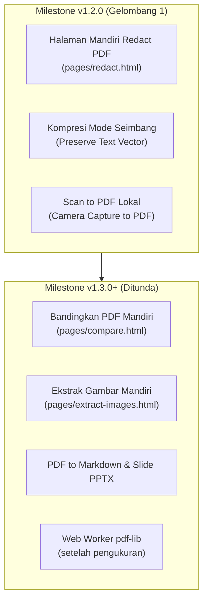

# 🗺️ PDF Tools — Master Roadmap & Status Pencapaian

> Dokumen ini adalah **satu-satunya dokumen rujukan (Single Source of Truth)** untuk peta jalan pengembangan dan optimalisasi proyek **PDF Tools**, mengonsolidasikan `IMPROVEMENT_PLAN.md` dan `IMPROVEMENT_ROADMAP.md`. Seluruh butir tunduk pada prinsip arsitektur `PROJECT_RULES.md` dan `AGENTS.md`.
>
> **Status:** Dimutakhirkan untuk rilis v1.1.0.

---

## ⚡ Prinsip Utama Proyek
1. **100% Client-Side Offline**: Seluruh pemrosesan berjalan di browser lokal pengguna (PDF-Lib, PDF.js, Tesseract.js, JSZip). Zero external server / API / cloud.
2. **Strict Design & Icon Standard**: Menggunakan inline SVG monokrom berukuran standar, dilarang menggunakan emoji visual pada kontrol antarmuka.
3. **Dual-Theme & Bilingual**: Mendukung Sleek Slate Dark & Clean Light theme serta dwibahasa (EN bawaan, ID tersedia) secara utuh.
4. **Verifikasi Test Ketat**: Setiap perubahan wajib disertai pembuktian test otomatis hijau (Playwright browser tests + Node test runner).

---

## 📊 Matriks Status Keseluruhan (Executive Summary)

| Bagian / Fitur | Status | Bukti / Catatan |
|---|---|---|
| **Fase Fondasi & Kualitas (Eks-Improvement Plan)** | | |
| 1. Seragamkan Struktur Footer | **Selesai** | `tests/check_footer_presence.js` (23 halaman), `js/app.js` |
| 2. SEO & Pratinjau Tautan (Open Graph, Sitemap) | **Selesai** | `scripts/build_seo.js`, `tests/check_seo_meta.js` (34 URL/meta) |
| 3. Aksesibilitas Dasar (A11y, Axe-core, Skip-Link) | **Selesai** | `tests/browser/test_a11y_axe.js` (0 violations di 23 halaman) |
| 4. ESLint untuk Skrip Inline HTML | **Selesai** | `eslint-plugin-html` di `eslint.config.js`, `npm run lint` 0 error |
| 5. Anggaran Ukuran Halaman & Uji Dokumen Besar | **Selesai** | `tests/browser/test_page_weight.js`, `tests/browser/test_large_documents.js` |
| 6a. Tipografi Font Inter Lokal Offline | **Selesai** | `fonts/Inter-*.woff2`, `@font-face` di `css/style.css` |
| 6b. Uji Perangkat Fisik (Samsung One UI, iOS Safari sentuhan nyata) | **Belum (menunggu pemilik)** | Emulasi sentuh 360-430px Playwright lulus; uji HP fisik manual menunggu pemilik |
| 7. Service Worker (Precache, Network-First, Vendor Cache) | **Selesai** | `sw.js`, `sw-manifest.json`, `tests/browser/test_service_worker.js` (6 skenario) |
| 8. Ekstraksi Skrip Inline ke Modul Terpisah | **Sebagian** | Logika inti telah diekstrak ke `js/pages/*.js`; inisialisasi DOM ringan divalidasi lint |
| 9. Content Security Policy (CSP Ketat & Tanpa Unsafe-Eval) | **Selesai** | `tests/check_csp_presence.js`, `tests/browser/test_csp.js`, `isEvalSupported: false` |
| **Peta Jalan Lanjutan (Eks-Improvement Roadmap)** | | |
| 1. Kelengkapan i18n Homepage (23 Alat, Pills, Mega Menu) | **Selesai** | `tests/check_i18n_homepage.js`, `index.html`, `js/utils/i18n.js` |
| 2. Halaman Mandiri Mesin Editor (Redact, Compare, Extract) | **Sebagian** | Redact PDF mandiri selesai di `pages/redact.html`; Compare & Extract dijadwalkan v1.3.0 |
| 3. Kompresi yang Mempertahankan Teks (Mode Seimbang) | **Selesai** | Mode Seimbang dengan downsampling JPEG stream selesai |
| 4. Web Worker untuk Pemrosesan pdf-lib | **Belum** | Profiling memori/UI thread menunggu pengujian performa mobile lanjutan |
| 5. Konversi Baru yang Layak Offline | **Belum** | Prioritas menengah v1.3.0 (misal: PDF ke PPTX slide gambar) |
| 6. PWA Manifest (Shortcuts, Screenshots, Bahasa) | **Selesai** | `manifest.json`, `tests/check_manifest_pwa.js`, screenshot desktop & mobile |
| 7. Pengetatan CSP (Pelepasan 'unsafe-eval') | **Selesai** | Dilepas dari CSP meta di semua halaman dengan `isEvalSupported: false` |
| 8. Test untuk Celah yang Belum Tertutup | **Sebagian** | Suite kartu Merge, Service Worker, CSP, PWA, dan i18n selesai |
| 9. CSS Modularisasi & Minifikasi | **Belum** | Ukuran file CSS saat ini masih berada di bawah batas anggaran performa |
| 10. Build Pipeline (Bundler) | **Belum** | Tidak disarankan dalam waktu dekat agar menjaga kesederhanaan static deployment |
| 11. PDF Studio untuk Mobile | **Belum** | Membutuhkan perancangan gesture / pointer events terpisah (PDF Studio Lite) |
| 12. Bahasa OCR Tambahan (Asia Tenggara) | **Belum** | Model bahasa saat ini berfokus pada ID dan EN untuk membatasi ukuran repositori |

---

## 🔍 Rincian Butir & Status Implementasi

### Bagian 1: Fondasi, Kualitas, & Keamanan (Fase Selesai pada v1.1.0)

#### 1. Struktur Footer Terpadu
- **Status**: **Selesai**
- **Implementasi**: Seluruh 23 halaman HTML publik menggunakan markup `<footer class="footer">` seragam dan diinisialisasi oleh `js/app.js` (`setupUnifiedFooter`).
- **Bukti Uji**: `tests/check_footer_presence.js` memvalidasi kehadiran elemen dan struktur tautan legal (License & Third-Party Notices).

#### 2. SEO, Meta Tags, & Open Graph
- **Status**: **Selesai**
- **Implementasi**: Skrip otomasi `scripts/build_seo.js` mengelola tag meta canonical, Open Graph (`og:title`, `og:description`, `og:image`, `og:url`), Twitter Card, serta menghasilkan `sitemap.xml` secara deterministik.
- **Bukti Uji**: `tests/check_seo_meta.js` mengaudit integritas SEO pada seluruh halaman.

#### 3. Aksesibilitas (A11y)
- **Status**: **Selesai**
- **Implementasi**: Tautan skip-link (`.skip-link`), kontras warna WCAG AA, navigasi keyboard penuh, aria-labels pada tombol ikonik, dan dialog focus trapping pada modal konfirmasi/password.
- **Bukti Uji**: `tests/browser/test_a11y_axe.js` menjalankan audit axe-core Playwright pada 23 halaman dengan 0 pelanggaran.

#### 4. Kualitas Kode Skrip Inline HTML
- **Status**: **Selesai**
- **Implementasi**: Plugin `eslint-plugin-html` terintegrasi pada `eslint.config.js`. Seluruh skrip inline HTML diperiksa terhadap deklarasi variabel, globals, dan sintaks.
- **Bukti Uji**: `npm run lint` menghasilkan 0 error dan 0 warning.

#### 5. Anggaran Ukuran Halaman & Pengujian Dokumen Besar
- **Status**: **Selesai**
- **Implementasi**: Pembatasan ukuran transfer halaman dan pemuatan model OCR secara dinamis (on-demand lazy loading). Pengujian file besar membuktikan pemrosesan ratusan halaman PDF berjalan stabil.
- **Bukti Uji**: `tests/browser/test_page_weight.js` dan `tests/browser/test_large_documents.js`.

#### 6. Tipografi Font Inter Lokal & Uji Perangkat Fisik
- **Status**: **Sebagian**
  - **Inter Font Lokal (Selesai)**: Font Inter WOFF2 (`Inter-Regular`, `Inter-Medium`, `Inter-SemiBold`) dihosting 100% lokal di folder `fonts/` dengan `@font-face` di `css/style.css`, bebas dari permintaan Google Fonts eksternal.
  - **Uji Perangkat Fisik**: **Belum (menunggu pemilik)**. Pengujian responsivitas dan sentuhan telah diverifikasi penuh via emulasi WebKit dan Chromium (360px - 430px). Pengujian pada gawai fisik Android/iOS nyata diserahkan kepada pemilik.

#### 7. Service Worker & PWA Caching
- **Status**: **Selesai**
- **Implementasi**:
  1. **Anti-Version Skew**: Menggunakan strategi Network-First dengan timeout 5 detik untuk aset aplikasi situs sendiri (`.html`, `.js`, `.css`), dengan cache sebagai fallback offline.
  2. **Cache Vendor OCR Terpisah**: Direktori `js/lib/**` dikelompokkan ke dalam `VENDOR_CACHE` (`pdf-tools-vendor-v<hash>`) yang tidak terhapus setiap deploy perubahan aplikasi ringan.
  3. **PWA Manifest Lengkap**: `manifest.json` dilengkapi `shortcuts` (Merge, Compress, Sign), `screenshots` (desktop wide & mobile narrow), `lang: "en"`, dan `dir: "ltr"`.
- **Bukti Uji**: `tests/check_sw_manifest.js`, `tests/check_manifest_pwa.js`, dan `tests/browser/test_service_worker.js` (6 skenario uji).

#### 8. Content Security Policy (CSP) Tanpa 'unsafe-eval'
- **Status**: **Selesai**
- **Implementasi**: Seluruh halaman mengimplementasikan `<meta http-equiv="Content-Security-Policy">`. Opsi `'unsafe-eval'` berhasil dihilangkan dengan menyetel `isEvalSupported: false` pada pemanggilan PDF.js di seluruh modul di luar Studio.
- **Bukti Uji**: `tests/check_csp_presence.js` dan `tests/browser/test_csp.js` (0 pelanggaran CSP).

#### 9. Kelengkapan i18n Homepage
- **Status**: **Selesai**
- **Implementasi**: Seluruh 23 deskripsi kartu alat, 7 tombol kategori filter, 7 judul kolom mega menu, tombol cancel/batch modal, serta tautan footer telah dilengkapi `data-i18n` dan terdaftar pada kamus `en` dan `id` di `js/utils/i18n.js`.
- **Bukti Uji**: `tests/check_i18n_homepage.js`.

---

## 🏛️ Keputusan Resmi Pemilik Proyek (Architectural Decisions)

Berdasarkan tinjauan arsitektur dan prinsip privasi client-side, pemilik proyek telah menetapkan keputusan strategis berikut:

1. **PDF Studio sebagai "Edit PDF"**:
   - PDF Studio (`pages/viewer.html`) tetap dipertahankan sebagai alat unggulan dan ditampilkan sebagai **"Edit PDF"** di seluruh navigasi publik.
   - Mengingat kepadatan fungsionalitasnya (teks edit, anotasi, live canvas), antarmuka ini dirancang paling optimal digunakan pada layar komputer/desktop. Untuk pengguna layar sentuh/ponsel, sistem menampilkan dialog edukasi pemakaian.
2. **Dwibahasa (EN & ID)**:
   - Mendukung penuh dua bahasa: Bahasa Inggris (`en`) sebagai bahasa bawaan internasional dan Bahasa Indonesia (`id`) untuk pengguna lokal, dengan penyimpanan preferensi di localStorage.
3. **Gelombang 1 (Milestone v1.2.0)**:
   - **Redaksi Mandiri (`pages/redact.html`)**: Membawa mesin redaksi permanen yang sudah teruji (`js/editor/redaction-engine.js`) ke halaman mandiri 6 bagian.
   - **Kompresi Seimbang**: Kompresi berbasis downsampling gambar internal tanpa merusak ketajaman teks vektor yang dapat dicari/diseleksi.
   - **Scan to PDF**: Konversi tangkapan kamera perangkat lokal menjadi dokumen PDF bersih tanpa server.
4. **Fitur yang Ditunda (Deferred)**:
   - **Bandingkan PDF Mandiri (`pages/compare.html`)**: Ditunda ke milestone berikutnya.
   - **Ekstrak Gambar (`pages/extract-images.html`)**: Ditunda ke milestone berikutnya.
   - **PDF to Markdown**: Ditunda.
   - **PDF to PowerPoint (Slide Gambar)**: Ditunda.
   - **Web Worker untuk Operasi pdf-lib**: Ditunda hingga ada bukti pengukuran empiris pada berkas besar di gawai seluler.
   - **Profil Test Cepat Browser (`npm run test:browser:quick`)**: Ditunda (test browser penuh membutuhkan ~7 menit, terlama audit header mobile ~191s).
5. **Fitur yang Ditolak (Rejected) & Alasan Penolakan**:
   - ❌ **Semua Fitur AI (Ringkasan AI, Chat Dokumen AI, Terjemahan AI)**: Ditolak mutlak karena bertentangan dengan prinsip privasi 100% offline di perangkat pengguna dan mengharuskan transmisi data ke API cloud pihak ketiga.
   - ❌ **Integrasi Cloud Eksternal (Google Drive, Dropbox, OneDrive)**: Ditolak karena melanggar garansi zero-external-URL dan memerlukan server backend untuk alur OAuth.
   - ❌ **HTML to PDF dari URL Web**: Ditolak karena mengambil konten web luar melanggar kebijakan sandbox offline dan batasan CORS.
   - ❌ **PowerPoint to PDF**: Ditolak karena merender dokumen presentasi kompleks dengan akurat di browser tanpa engine Office asli tidak layak secara teknis.
   - ❌ **Konversi PDF/A Tanpa Validator**: Ditolak karena kepatuhan standar arsip PDF/A memerlukan validator spesifikasi ketat; mengklaim format tanpa pembuktian melanggar integritas klaim.

---

## 🚀 Peta Jalan Fitur Mendatang (Next Milestone: v1.2.0+)

### Gelombang 1 (Target v1.2.0)

1. **Halaman Mandiri Redact PDF (`pages/redact.html`)**:
   - Memanfaatkan `js/editor/redaction-engine.js` untuk redaksi permanen mandiri dengan verifikasi anti-bocor piksel (`test_redaction_rasterize.js`).
   - *Status*: **Selesai**.
2. **Kompresi yang Mempertahankan Teks (Mode Seimbang)**:
   - Kompresi stream gambar internal dokumen tanpa merasterisasi teks vektor atau menghapus text-layer.
   - *Status*: **Selesai**.
3. **Scan to PDF**:
   - Mengambil tangkapan kamera perangkat pengguna atau gambar dokumen lokal untuk dikompilasi menjadi PDF multi-halaman.
   - *Status*: **Selesai**.

### Fitur Ditunda (Target v1.3.0+)

4. **Bandingkan PDF & Ekstrak Gambar**:
   - Membangun antarmuka mandiri untuk `compare-engine.js` dan `image-extractor.js`.
5. **Konversi Format Ringan**:
   - PDF ke Markdown (ekstraksi teks berstruktur) dan PDF ke slide PowerPoint gambar.
6. **Web Worker untuk Operasi Berat pdf-lib**:
   - Pemindahan kalkulasi pdf-lib ke worker latar belakang setelah profil performa menunjukkan kebutuhan mendesak.
   - *Status*: **Belum**.
7. **Profil Test Cepat Browser (`npm run test:browser:quick`)**:
   - Menambahkan profil pengujian cepat yang melewati audit visual/header berat untuk iterasi pengembangan cepat (test browser penuh membutuhkan ~7 menit, terlama audit header mobile ~191s).
   - *Status*: **Belum**.
